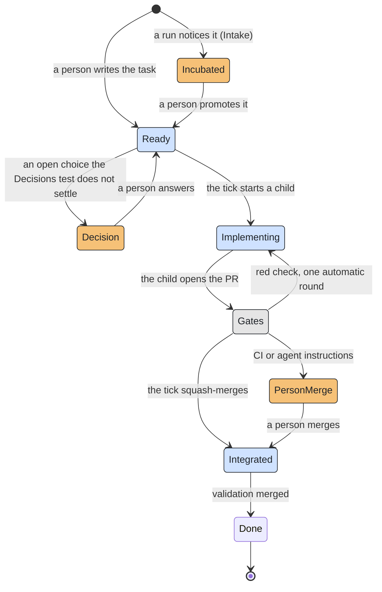

# Agentic Workflow — IMAGEM:SP

> Generated by `/flow-setup` from `.claude/flow.md` on 2026-11-17. Do not edit: change the parameters or the rules they point to, then run `/flow-setup audit`.

Work lives in the Flow project `proj_7x0hj7zhe7`, under the standing decision [`task_narxs91dg4`](https://flow.ttoss.dev/app/tasks/task_narxs91dg4); GitHub holds the code and its changes, in `delbem-research/imagemsp`. It runs the ttoss [Agentic Workflow](https://ttoss.dev/docs/engineering/workflow): every run reads a task's state from Flow, acts and writes it back, so the next run starts from the graph. The tick takes what ages fastest first ([process](https://ttoss.dev/docs/engineering/workflow/process#three-rules), rule 3).

Blue: a routine's run acts next. Orange: a person. Grey: automation.

| Stage     | Routine                                      | Person                                               | Automation                                       | Governed by                   |
| --------- | -------------------------------------------- | ---------------------------------------------------- | ------------------------------------------------ | ----------------------------- |
| Intake    | what runs notice becomes an `incubated` task | a person writes tasks                                | —                                                | `Intake`                      |
| Decide    | —                                            | the default reserved classes                         | —                                                | `Decisions`, `Ready brief`    |
| Implement | the tick starts a child per ready task       | a person working a task in their own session         | —                                                | `Before proposing`            |
| Gates     | —                                            | —                                                    | the `pr` check: typecheck, lint, test            | `Review` (none), `Merge rule` |
| Integrate | the tick squash-merges                       | a person merges changes to CI and agent instructions | —                                                | `Merge rule`                  |
| Release   | —                                            | —                                                    | every merge to `main` deploys, outside this repo | `Release procedure`           |
| Verify    | the tick closes `merged` tasks               | —                                                    | —                                                | `Closing evidence`            |

## Routines

| Routine | What it does                                                                                 | Runs                             | Here                                                                  |
| ------- | -------------------------------------------------------------------------------------------- | -------------------------------- | --------------------------------------------------------------------- |
| Tick    | moves tasks through the stages: delegates, integrates, releases, verifies                    | `/flow proj_7x0hj7zhe7`          | hourly on weekdays 09:00–18:00 `America/Sao_Paulo`, `claude-opus-5-5` |
| Chase   | tells each person what waits on them                                                         | `/flow proj_7x0hj7zhe7 --chase`  | not set up                                                            |
| Health  | reports how the work flows, and proposes a standing rule from an answer given more than once | `/flow proj_7x0hj7zhe7 --health` | not set up                                                            |
| Audit   | finds where the agents spend tokens, files each fix as a task                                | `/token-audit --routine`         | not set up                                                            |

## Where each piece lives

| What                                  | Where                                                                                                                |
| ------------------------------------- | -------------------------------------------------------------------------------------------------------------------- |
| The method                            | [Get Things Flowing](https://flow.ttoss.dev/docs/agents/protocol.md)                                                 |
| The workflow                          | [Agentic Workflow](https://ttoss.dev/docs/engineering/workflow)                                                      |
| The skills                            | `flow`, `flow-setup`, `flow-friction`, `flow-me`, `token-audit`, `instruction-hygiene`, pinned in `skills-lock.json` |
| The parameters                        | `.claude/flow.md`                                                                                                    |
| The entry section every session loads | `CLAUDE.md` § Flow                                                                                                   |
| Run records (hook)                    | `.claude/skills/flow/scripts/session-run.mjs`, wired in `.claude/settings.json`                                      |
| Required check                        | `.github/workflows/pr.yml`                                                                                           |
| Quality gates and conventions         | `README.md`                                                                                                          |
